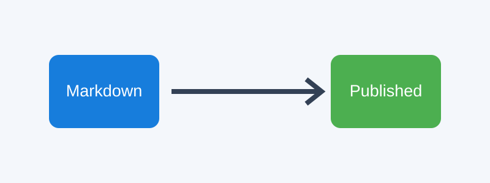
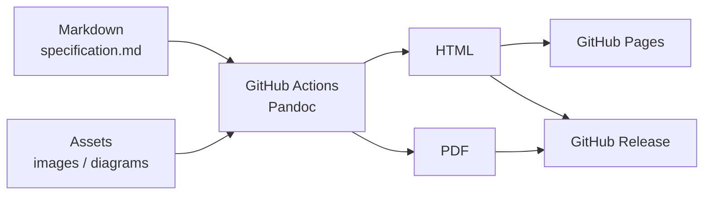

# Documentation Pipeline Test

This is a minimal Markdown document used to test a GitHub publishing pipeline.

## Picture / asset test

The image below is referenced with a **relative path**:

## Formatting test

- Markdown source remains easy to review in Git.
- HTML is generated with Pandoc and a CSS template.
- PDF is generated with Pandoc and XeLaTeX.

### Small table

| Item | Value |
|---|---:|
| Pumps | 2 |
| Water volume | 50 m³ |

### Math test

Inline math: $Q = vA$.

Display math:

$$
V = L \times W \times D
$$

## Mermaid diagram test

The following Mermaid source describes the documentation publishing flow:

## Version

The release version is supplied by the Git tag used to trigger the workflow.
