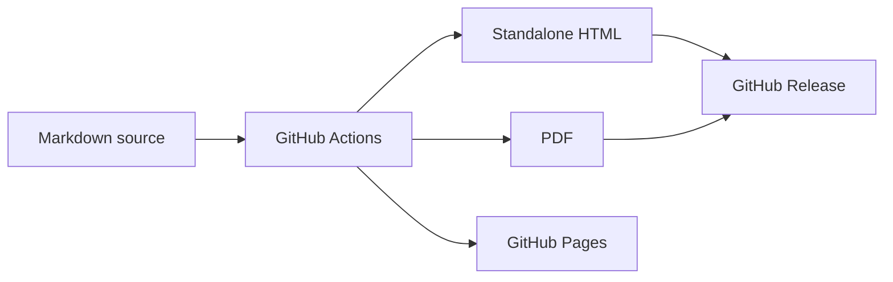

# Purpose

This small document validates the complete GitHub documentation pipeline.

It includes normal Markdown, a repository asset, mathematics, a table, and a Mermaid diagram.

## Repository asset

The image below is stored in `docs/assets/` and referenced with a relative path.

## Mermaid diagram

## Example content

An inline equation: $E = mc^2$.

| Output | Purpose |
|---|---|
| HTML | Portable, self-contained download |
| PDF | Portable release document |
| Pages | Public online documentation |

## Release behavior

A manual workflow run builds and validates artifacts without publishing them. A pushed tag matching `v*`, such as `v0.1.0`, also creates a GitHub Release and deploys GitHub Pages.